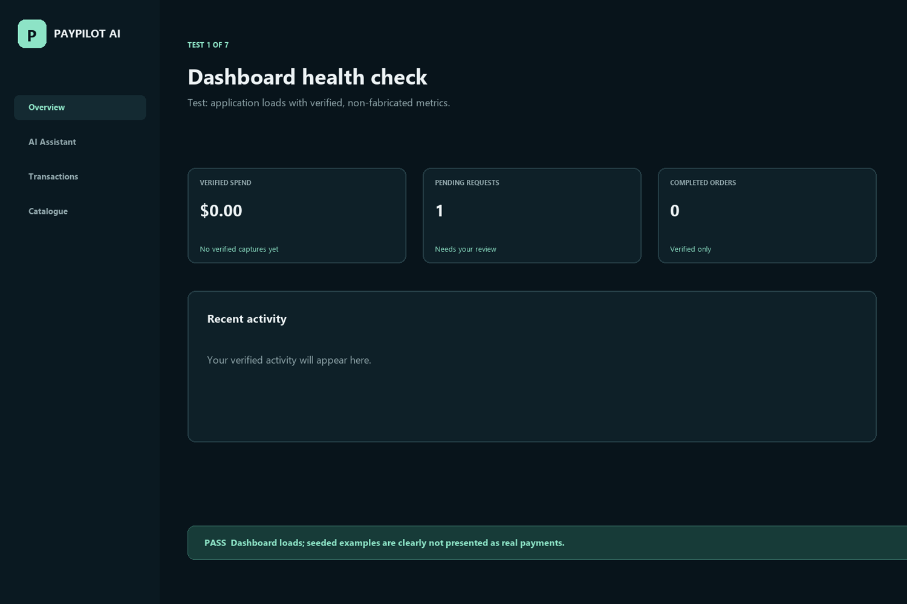

# PayPilot AI

### Your AI Purchasing Agent. Your Money, Your Rules.

PayPilot AI is a controlled procurement agent for small teams. It turns a natural-language request into a catalogue-grounded purchase plan, validates the budget on the server, and routes an explicitly approved order through PayPal Sandbox.

> AI recommends. A human approves. PayPal verifies.

## Demo

[](https://youtu.be/KGiKKHR6ut4)

Click the image to watch the narrated, subtitled tutorial on YouTube.

Live demo: [paypilot-ai-u0is.onrender.com](https://paypilot-ai-u0is.onrender.com)

Source code: [github.com/tanaygt/PAYPILOT-AI](https://github.com/tanaygt/PAYPILOT-AI)

## Product media



The Devpost image gallery can use these 3:2 screenshots:

- [Dashboard](project-media/01-dashboard.png)
- [AI purchase plan](project-media/02-ai-plan.png)
- [PayPal approval](project-media/03-paypal-approval.png)
- [Transaction history](project-media/04-transaction-history.png)

## What it does

1. A user describes a purchasing need, quantities, budget, and preferences.
2. Groq interprets the request; a deterministic fallback keeps the demo usable without an AI key.
3. The server matches products from its seeded catalogue and recalculates every price.
4. The user reviews products, quantities, totals, and budget status.
5. Only an explicit approval can start PayPal Sandbox checkout.
6. The server verifies the PayPal capture before recording a transaction.

## Implemented features

- Groq-powered structured procurement planning with safe fallback.
- Seeded monitors, office chairs, keyboards, laptops, desks, and accessories catalogue.
- Server-side Zod validation for requests, quantities, availability, budgets, and prices.
- Human-in-the-loop approval gate.
- PayPal Orders API v2 Sandbox create-order and capture verification flow.
- AG Grid Community transaction history.
- Responsive dark fintech dashboard for desktop, tablet, and mobile.
- Rate limiting, environment-based secrets, audit-friendly transaction persistence, and error feedback.

## Run locally

Requirements: Node.js 20+.

```powershell
npm install
Copy-Item .env.example .env
npm run dev
```

Open [http://localhost:5173](http://localhost:5173).

Add these values to `.env` for the full integration:

```env
GROQ_API_KEY=your_groq_key
GROQ_MODEL=llama-3.3-70b-versatile
PAYPAL_CLIENT_ID=your_sandbox_client_id
PAYPAL_CLIENT_SECRET=your_sandbox_client_secret
PAYPAL_ENV=sandbox
MAX_PURCHASE_USD=5000
```

Never commit `.env`. It is ignored by Git.

## Verification

```powershell
npm run build
npm test
```

Verified locally and on Render: health endpoint, valid planning request, invalid input rejection, budget validation, PayPal Sandbox order creation, responsive layout rules, and secret scanning.

## Honest limitations

- The catalogue is seeded demonstration data, not live supplier inventory.
- A completed PayPal capture requires a PayPal Sandbox buyer account and browser approval.
- JSON persistence is suitable for the MVP demo; production should use durable storage and idempotency keys.
- The free Render instance may sleep and take longer to respond after inactivity.

## Documentation

- [Product requirements](PRD.md)
- [Architecture](ARCHITECTURE.md)
- [API documentation](API_DOCUMENTATION.md)
- [Security notes](SECURITY.md)
- [Testing notes](TESTING.md)
- [Devpost submission copy](DEVPOST_SUBMISSION.md)

## License

MIT
